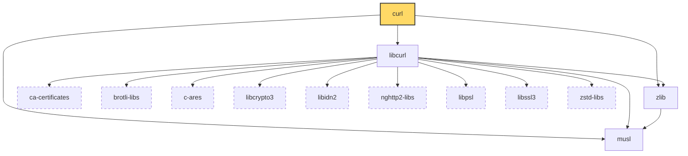
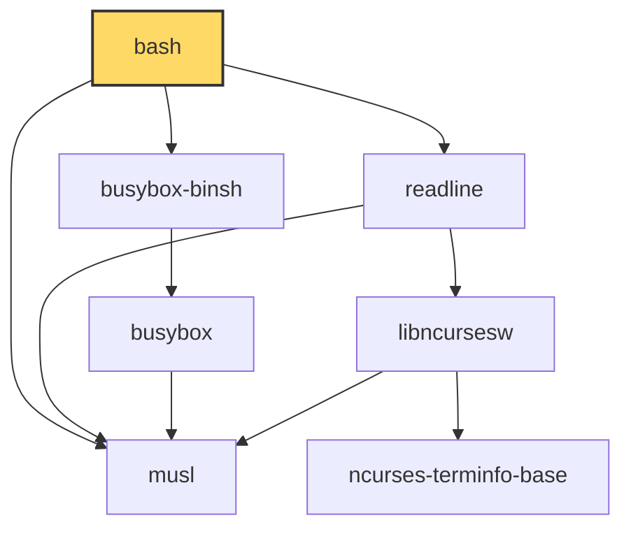
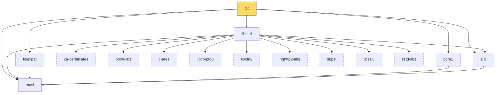
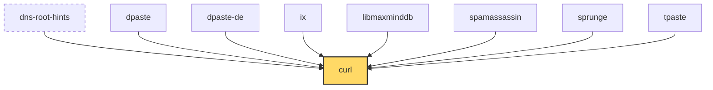
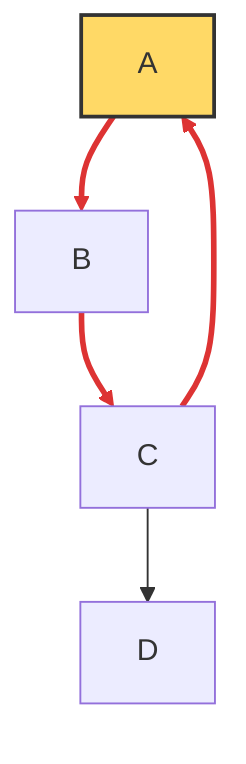

# Визуализатор графа зависимостей (вариант 28)

Учебный проект по дисциплине "Конфигурационное управление",
практическая работа 2. Инструмент строит граф зависимостей пакетов
Alpine Linux (apk) без использования менеджеров пакетов и сторонних
библиотек.

## Общее описание

Инструмент написан на Python 3 и работает в командной строке.
Все параметры задаются в конфигурационном файле формата XML.

Этап 1 - минимальный прототип с конфигурацией:

- параметры читаются из XML-файла, путь к нему задаётся ключом
  `--config` (по умолчанию `config.xml`);
- для каждого параметра есть проверка и понятное сообщение об ошибке.

Этап 2 - сбор данных:

- используется формат пакетов Alpine Linux (apk);
- из репозитория по URL скачивается индекс `APKINDEX.tar.gz`,
  распаковывается и разбирается стандартной библиотекой Python,
  без менеджера пакетов apk и сторонних библиотек.

Этап 3 - основные операции:

- граф зависимостей строится с учётом транзитивности обходом в ширину
  (BFS) без рекурсии;
- анализ ограничен максимальной глубиной `<max_depth>`;
- пакеты, в имени которых есть подстрока `<filter>`, не учитываются;
- циклические зависимости обрабатываются: обход завершается, а циклы
  выводятся отдельно;
- режим тестирования: вместо URL можно указать файл, описывающий граф
  репозитория из пакетов с именами из больших латинских букв.

Этап 4 - дополнительные операции:

- режим обратных зависимостей `<reverse>true</reverse>`: на экран
  выводятся пакеты, которые зависят от заданного, прямо или через
  другие пакеты;
- используется тот же обход в ширину из этапа 3 (с глубиной, фильтром
  и обработкой циклов), только соседями пакета считаются зависящие
  от него пакеты;
- режим работает и на настоящем репозитории Alpine, и на тестовом.

Этап 5 (текущий) - визуализация:

- граф выводится на экран в виде описания на языке диаграмм Mermaid;
- если включён параметр `<ascii_tree>`, после диаграммы выводится ещё и
  ASCII-дерево зависимостей;
- результаты сравнены с официальным просмотрщиком пакетов Alpine (раздел
  "Сравнение со штатными инструментами").

## Устройство программы

| Файл | Назначение |
| --- | --- |
| `src/main.py` | точка входа: конфигурация, репозиторий, граф, вывод |
| `src/config.py` | чтение и проверка конфигурации XML |
| `src/apk.py` | скачивание и разбор индекса Alpine, зависимости пакета |
| `src/testrepo.py` | разбор файла тестового репозитория |
| `src/repository.py` | единый интерфейс к Alpine и к тестовому файлу: зависимости и обратные зависимости пакета |
| `src/graph.py` | обход графа в ширину (прямой и обратный), фильтр, поиск циклов |
| `src/mermaid.py` | описание графа на языке Mermaid |
| `src/tree.py` | вывод графа ASCII-деревом |
| `src/errors.py` | виды ошибок |

## Как строится граф

Алгоритм работает с очередью, рекурсия не используется:

1. Анализируемый пакет получает глубину 0 и ставится в очередь.
2. Из очереди берётся пакет, определяются его зависимости, из них
   убираются пакеты с подстрокой фильтра.
3. Если глубина пакета меньше `max_depth`, его зависимости
   записываются в граф, а ещё не встречавшиеся из них получают
   глубину на 1 больше и ставятся в очередь.
4. Если глубина равна `max_depth`, зависимости пакета не раскрываются,
   на диаграмме они нарисованы пунктирной рамкой и перечислены в
   комментарии.
5. Шаги 2-4 повторяются, пока очередь не опустеет.

Правила:

- пакет попадает в граф один раз, с наименьшей глубиной, на которой
  он найден (поэтому общая зависимость не дублируется);
- уже встреченный пакет повторно в очередь не ставится, поэтому при
  цикле обход всегда заканчивается;
- глубина 1 означает "сам пакет и его прямые зависимости";
- фильтр сравнивается с именем с учётом регистра; исключённый пакет
  не входит в граф, а пакеты, доступные только через него, не
  обходятся; если фильтру удовлетворяет сам анализируемый пакет,
  программа сообщает об ошибке;
- циклы ищутся после построения обходом в глубину с явным стеком
  (тоже без рекурсии): зависимость, которая ведёт в пакет, лежащий
  на текущем пути, образует цикл. Если цикл замыкается за пределом
  глубины, он не виден, потому что эти зависимости не раскрыты.

## Визуализация

Граф выводится в виде текста на языке диаграмм
[Mermaid](https://mermaid.js.org). Этот текст можно вставить на сайт
https://mermaid.live или в блок ```` ```mermaid ```` любого файла Markdown:
GitHub (в том числе в этом README) рисует такие блоки сам.

Как читать диаграмму:

- стрелка `A --> B` означает "A зависит от B";
- закрашенный узел это анализируемый пакет;
- узел с пунктирной рамкой это пакет, у которого связи не раскрыты из-за
  ограничения глубины;
- красные толстые стрелки образуют циклические зависимости;
- у узлов служебные имена `n0`, `n1`, ..., а настоящее имя пакета
  стоит в подписи: в именах бывают точки и плюсы (`lua5.4-curl`,
  `libstdc++`), которые Mermaid не принимает в идентификаторах;
- строки, начинающиеся с `%%`, это комментарии: в них записаны вид
  графа, глубина, фильтр, найденные циклы и пакеты с нераскрытыми
  связями.

ASCII-дерево (параметр `<ascii_tree>`) рисуется обходом в глубину с
явным стеком, без рекурсии:

- пакет раскрывается там, где встретился первым, а при повторе рядом
  стоит пометка `(см. выше)`; повторный пакет без зависимостей
  пометки не получает;
- пакет, который ведёт обратно в пакет на текущем пути, получает
  пометку `(цикл)`;
- пакеты с нераскрытыми из-за глубины связями получают `...`.

## Обратные зависимости

Обратные зависимости пакета P это пакеты, которые зависят от P.
Режим включается параметром `<reverse>true</reverse>`.

- Обход тот же, что и для прямых зависимостей: очередь, глубина,
  фильтр, один раз на пакет. Отличается только тем, откуда берутся
  соседи: не "от чего зависит пакет", а "кто от него зависит".
- Глубина 1 это пакеты, которые зависят от P напрямую, глубина 2 это
  пакеты, зависящие от них, и так далее.
- Стрелки на диаграмме идут в обычном направлении: `A --> B` значит
  "A зависит от B". Анализируемый пакет P при этом стоит справа от
  стрелок, ведущих к нему.
- Фильтр работает так же: пакет с подстрокой и всё, что доступно
  только через него, не учитывается.
- Циклы записываются по направлению зависимостей, как и в прямом
  режиме.
- Для настоящего репозитория Alpine при первом запросе по всему
  индексу строится таблица "пакет -> кто от него зависит"
  (около 5500 пакетов), дальше она используется повторно.
- К пакетам-зависимым относятся и вспомогательные пакеты: `curl-dev`,
  `libpsl-utils` и подобные, потому что они тоже записывают
  зависимость в поле `D`.

Если пакет никому не нужен, список обратных зависимостей пуст.

## Тестовый репозиторий

Режим включается так: `<test_mode>true</test_mode>`, а в
`<repository>` указывается путь к файлу. Формат файла, одна строка
на пакет:

```
# всё после решётки это комментарий
A: B C      пакет A зависит от B и C
B: D
C: D
D:          пакет D ни от чего не зависит
```

- имена пакетов состоят только из больших латинских букв;
- зависимости разделяются пробелами или запятыми;
- зависимость, у которой нет своей строки, считается пакетом без
  зависимостей;
- пакет можно описать только один раз.

Примеры лежат в каталоге `repos`:

| Файл | Что проверяет |
| --- | --- |
| `tree.txt` | простое дерево |
| `diamond.txt` | ромб: общая зависимость, нужная двум пакетам |
| `wide.txt` | пакет встречается на разных глубинах |
| `chain.txt` | длинная цепочка для проверки глубины |
| `cycle.txt` | цикл A -> B -> C -> A |
| `self_loop.txt` | пакет зависит сам от себя |
| `two_cycles.txt` | два отдельных цикла |
| `errors/*.txt` | неверные файлы: строчные буквы, цифра в имени, нет двоеточия, повтор, пустой файл |

## Как читаются зависимости apk

Индекс `APKINDEX` это текстовый файл: описания пакетов разделены
пустой строкой, каждая строка имеет вид `буква:значение`.

```
P:curl
V:8.14.1-r2
D:libcurl=8.14.1-r2 so:libc.musl-x86_64.so.1 so:libcurl.so.4 so:libz.so.1
p:cmd:curl=8.14.1-r2
```

| Поле | Значение |
| --- | --- |
| `P` | имя пакета |
| `V` | версия |
| `D` | зависимости через пробел |
| `p` | виртуальные имена, которые пакет предоставляет |

Каждая зависимость обрабатывается так:

- ограничение версии отрезается: `libcurl=8.14.1-r2` даёт `libcurl`,
  `libssl3>=3.3.0` даёт `libssl3`;
- конфликты вида `!имя` не являются зависимостями и пропускаются;
- если имя это пакет из индекса, берётся он;
- иначе это виртуальное имя (`so:` библиотека, `cmd:` команда,
  путь вроде `/bin/sh`), и ищется пакет, у которого это имя есть
  в поле `p`. Например, `so:libz.so.1` даёт пакет `zlib`;
- несколько зависимостей, ведущих в один пакет, и зависимость пакета
  от самого себя (через собственные виртуальные имена) в граф не
  попадают.

Если одно виртуальное имя предоставляют несколько пакетов (например,
`/bin/sh` есть в `busybox-binsh`, `dash-binsh` и `yash-binsh`),
берётся первый по порядку индекса. Настоящий apk выбирает по
приоритету и по уже установленным пакетам, поэтому в таких редких
случаях его выбор может отличаться.

## Параметры конфигурации

| Тег | Описание | Значение | По умолчанию |
| --- | --- | --- | --- |
| `<package>` | имя анализируемого пакета | латинские буквы, цифры, `.`, `_`, `+`, `-` | обязательный |
| `<repository>` | URL репозитория или путь к файлу тестового репозитория | в обычном режиме URL с `http://` или `https://`, в тестовом путь к существующему файлу | обязательный |
| `<test_mode>` | режим работы с тестовым репозиторием | `true` или `false` | `false` |
| `<ascii_tree>` | вывод зависимостей ASCII-деревом после диаграммы | `true` или `false` | `false` |
| `<max_depth>` | максимальная глубина анализа | целое число не меньше 1 | `10` |
| `<filter>` | пакеты с этой подстрокой в имени не учитываются | строка без пробелов | пусто |
| `<reverse>` | вывод обратных зависимостей (кто зависит от пакета) | `true` или `false` | `false` |

Пример `config.xml`:

```xml
<config>
  <package>curl</package>
  <repository>https://dl-cdn.alpinelinux.org/alpine/v3.20/main/x86_64</repository>
  <test_mode>false</test_mode>
  <ascii_tree>true</ascii_tree>
  <max_depth>3</max_depth>
  <filter>dev</filter>
  <reverse>false</reverse>
</config>
```

## Обработка ошибок

Программа сообщает об ошибке и завершается с кодом 1, если:

- файл конфигурации не найден или XML испорчен;
- корневой тег не `<config>`, встречен неизвестный или повторный тег;
- не задан `<package>` или `<repository>`, имя пакета недопустимо;
- в обычном режиме репозиторий не URL, в тестовом файл не существует;
- `<test_mode>`, `<ascii_tree>` или `<reverse>` не `true`/`false`;
- `<max_depth>` не целое число или меньше 1;
- `<filter>` содержит пробелы.

Для каждой ошибки есть пример в каталоге `configs/errors`.

Ошибки репозитория дают код завершения 2:

- сервер недоступен или адрес не существует;
- сервер вернул ошибку (например, 404 для неверной версии Alpine);
- архив индекса повреждён или в нём нет файла `APKINDEX`;
- пакета нет в репозитории;
- анализируемый пакет исключён фильтром;
- файл тестового репозитория записан неверно (сообщение содержит
  номер строки).

## Сборка и запуск

Сборка не требуется, нужен только Python 3.10 или новее. Для
настоящего репозитория Alpine нужен интернет, тестовый режим
работает без сети.

```
run.bat                                   # Windows, файл config.xml
./run.sh                                  # Linux и macOS
python -m src.main --config config.xml
```

Скрипты демонстрации (каждый запускает программу на наборе
конфигураций из каталога `configs`):

| Скрипт | Что показывает |
| --- | --- |
| `scripts\stage1_errors.bat` | ошибки всех параметров конфигурации |
| `scripts\stage2_deps.bat` | прямые зависимости пакетов (глубина 1) и ошибки загрузки |
| `scripts\stage3_graph.bat` | граф на тестовых репозиториях, цикл, фильтр, глубина, ошибки, настоящий Alpine |
| `scripts\stage4_reverse.bat` | обратные зависимости: тестовые репозитории, цикл, фильтр, ошибки, настоящий Alpine |

| `scripts\stage5_visualize.bat` | диаграмма Mermaid и ASCII-дерево: цикл, глубина, ромб, обратные зависимости, три пакета Alpine |

Для Linux и macOS те же скрипты с расширением `.sh`. Скрипты этапов 3 и 4
после этапа 5 выводят результат в виде диаграммы, то есть те же случаи
(глубина, фильтр, циклы, обратный режим) видны на диаграммах.

## Запуск тестов

```
python -m unittest discover -s tests -t .
```

## Примеры использования

Три разных пакета настоящего репозитория Alpine (`scripts\stage5_visualize.bat`). Ниже готовые диаграммы: на GitHub они отображаются как рисунки.

### Пример 1: curl, глубина 2 (`configs/stage5/real_curl.xml`)



```text
ASCII-дерево зависимостей пакета curl:
curl
|-- libcurl
|   |-- ca-certificates ...
|   |-- brotli-libs ...
|   |-- musl
|   |-- c-ares ...
|   |-- libcrypto3 ...
|   |-- libidn2 ...
|   |-- nghttp2-libs ...
|   |-- libpsl ...
|   |-- libssl3 ...
|   |-- zlib
|   |   `-- musl
|   `-- zstd-libs ...
|-- musl
`-- zlib (см. выше)
```

### Пример 2: bash целиком (`configs/stage5/real_bash.xml`)



```text
ASCII-дерево зависимостей пакета bash:
bash
|-- busybox-binsh
|   `-- busybox
|       `-- musl
|-- musl
`-- readline
    |-- musl
    `-- libncursesw
        |-- ncurses-terminfo-base
        `-- musl
```

### Пример 3: git, глубина 2 (`configs/stage5/real_git.xml`)



```text
ASCII-дерево зависимостей пакета git:
git
|-- musl
|-- libcurl
|   |-- ca-certificates ...
|   |-- brotli-libs ...
|   |-- musl
|   |-- c-ares ...
|   |-- libcrypto3 ...
|   |-- libidn2 ...
|   |-- nghttp2-libs ...
|   |-- libpsl ...
|   |-- libssl3 ...
|   |-- zlib
|   |   `-- musl
|   `-- zstd-libs ...
|-- libexpat
|   `-- musl
|-- pcre2
|   `-- musl
`-- zlib (см. выше)
```

### Обратные зависимости: кто зависит от curl, глубина 1 (`configs/stage5/real_reverse_curl.xml`)



```text
ASCII-дерево обратных зависимостей пакета curl:
curl
|-- dns-root-hints ...
|-- dpaste
|-- dpaste-de
|-- ix
|-- libmaxminddb
|-- spamassassin
|-- sprunge
`-- tpaste
```

### Цикл в тестовом репозитории (`configs/stage5/test_cycle.xml`): красные стрелки это цикл A -> B -> C -> A



```text
ASCII-дерево зависимостей пакета A:
A
`-- B
    `-- C
        |-- A (цикл)
        `-- D
```

### Ошибки

```
> run.bat --config configs\errors\bad_reverse.xml
ошибка конфигурации: параметр <reverse> должен быть true или false, получено: sometimes

> run.bat --config configs\stage3\error_root_filtered.xml
ошибка репозитория: пакет A исключён фильтром 'A': его имя содержит подстроку фильтра

> run.bat --config configs\stage3\error_duplicate.xml
ошибка репозитория: строка 4: пакет A описан дважды
```

Остальные случаи (глубина, фильтр, ромб, самозацикливание, два цикла,
обратные зависимости с фильтром и ошибки файла репозитория) лежат в
каталогах `configs/stage3`, `configs/stage4` и `configs/stage5` и
запускаются скриптами `stage3_graph`, `stage4_reverse` и
`stage5_visualize`.

## Сравнение со штатными инструментами

Штатные средства apk (`apk info -R` для зависимостей, `apk info -r`
для обратных зависимостей и `apk dot`, которая рисует граф в формате
Graphviz) работают только в самой системе Alpine Linux. В среде, где
выполнена эта работа (Windows), запустить их не удалось, поэтому эти
команды не запускались, а сравнение выполнено с официальным
просмотрщиком пакетов Alpine https://pkgs.alpinelinux.org. Он построен
по тому же индексу `APKINDEX` и для каждого пакета показывает списки
"Depends" (от чего зависит) и "Required by" (кто зависит).

**Прямые зависимости.** Для каждого пакета каждого из трёх графов
(`curl`: 16 пакетов, `bash`: 7, `git`: 18, глубина без ограничения)
список зависимостей, найденный программой, сравнён со списком "Depends"
на сайте. Расхождений нет ни у одного пакета.

Различие только в записи: сайт показывает исходные строки, например у
curl четыре (`libcurl`, `so:libc.musl-x86_64.so.1`, `so:libcurl.so.4`,
`so:libz.so.1`), а программа сворачивает их в пакеты, и две строки,
ведущие в `libcurl`, дают одно ребро. Виртуальные имена (`so:...`)
сайт разворачивает в те же пакеты, что и программа.

**Обратные зависимости.** Версия 3.20, пакеты репозитория `main`:

| Пакет | Required by на сайте | Программа, только main | Программа, main + community |
| --- | --- | --- | --- |
| curl | 33 | 8 | 33 |
| bash | 105 | 22 | 105 |
| git | 59 | 22 | 59 |
| libpsl | 12 | 3 | 12 |

Если указан один репозиторий `main`, программа находит меньше
пакетов, чем показывает сайт. Причина: сайт учитывает и пакеты
репозитория `community`, которые зависят от пакетов из `main`, а
программа видит только тот репозиторий, URL которого указан в
`<repository>`. Это проверено: если объединить индексы `main` и
`community` (скриптом сравнения, а не самой программой), списки
совпадают полностью, пакет в пакет. Значит, расхождение объясняется
составом репозиториев, а не алгоритмом.

Ограничение: программа работает с одним репозиторием, как требует
задание ("URL-адрес репозитория"). Для прямых зависимостей это не
мешает, пока пакеты и их зависимости лежат в одном репозитории. Для
обратных зависимостей результат полон только для того репозитория,
который указан. Настоящий apk читает все репозитории из
`/etc/apk/repositories` (обычно `main` и `community`).

**Что ещё отличается от штатных инструментов.**

- Программа ограничивает глубину и умеет исключать пакеты по
  подстроке, а список на сайте всегда показывает только один уровень.
- Если виртуальное имя предоставляют несколько пакетов (`/bin/sh`
  есть в `busybox-binsh`, `dash-binsh` и `yash-binsh`), программа
  берёт первый по порядку индекса, а настоящий apk выбирает по
  приоритету и по уже установленным пакетам. На проверенных пакетах
  это не дало расхождений, но в общем случае выбор может отличаться.
- Формат вывода другой: Mermaid вместо Graphviz (`apk dot`) и
  дополнительно ASCII-дерево.
